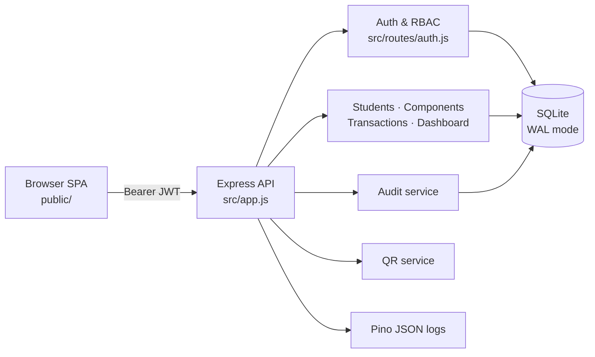
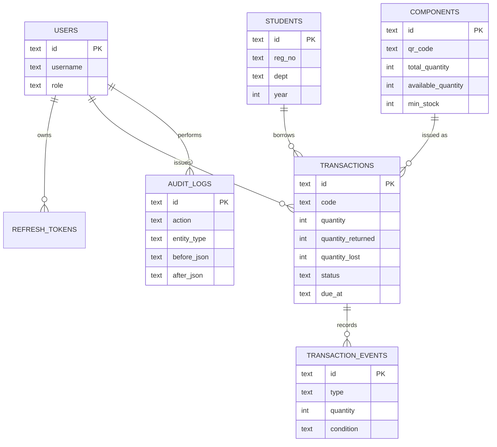

<div align="center">

# ⚡ Circuit — ECE Component Tracking System

**Industry-grade inventory, issue/return and QR tracking for electronics laboratories.**

[](https://github.com/Harishwaran18/Component-tracking-system/actions/workflows/ci.yml)
[](https://nodejs.org)
[](LICENSE)
[](#testing)
[](Dockerfile)

</div>

---

## Overview

Circuit replaces paper registers and spreadsheets in an ECE laboratory with a single, auditable
web application. Track every resistor, IC, instrument and development board from the moment it is
catalogued to the moment it is returned — with QR labels, role-based access, overdue alerts and a
complete audit trail.

It ships as one deployable Node.js service: a hardened REST API, a polished single-page dashboard,
and a SQLite database that needs zero external infrastructure.

## Highlights

| Area | What you get |
| --- | --- |
| **Inventory** | Component catalogue, stock levels, minimum-stock alerts, conditions, locations, unit cost, restocking, CSV export |
| **QR tracking** | Auto-generated unique QR code per component, printable labels, scan/lookup endpoint |
| **Issue & return** | Issue to students with due dates, partial returns, damaged write-offs, lost-item handling, overdue detection |
| **Students** | Registration numbers, department/year, active-loan counts, full loan history |
| **Dashboard** | Live KPIs, 30-day issue/return chart, category distribution, low-stock and recent activity |
| **Security** | JWT access + rotating refresh tokens, bcrypt hashing, RBAC, account lockout, Helmet CSP, rate limiting, input validation |
| **Audit** | Immutable log of every mutation with actor, IP, user agent and before/after snapshots |
| **Operations** | Health/readiness probes, structured JSON logs, graceful shutdown, Docker image, CI pipeline |
| **UX** | Responsive dark UI, skeleton loaders, toasts, modals, keyboard-friendly forms, mobile drawer navigation |

## Tech stack

- **Runtime:** Node.js 20+ (tested on 22/24)
- **API:** Express 4, Zod validation, JWT, bcryptjs, Helmet, CORS, express-rate-limit, Pino
- **Database:** SQLite via better-sqlite3 (WAL mode, foreign keys, transactional writes)
- **Frontend:** Framework-free SPA — semantic HTML, modern CSS design system, vanilla ES modules (no build step)
- **QR:** `qrcode` (PNG data URLs + buffers)
- **Testing:** Jest + Supertest (37 integration tests)
- **Deployment:** Multi-stage Dockerfile, Docker Compose, Procfile, GitHub Actions

## Architecture



### Data model



## Quick start

### Local

```bash
# 1. Install dependencies
npm install

# 2. Create your environment file
cp .env.example .env
#    Edit .env and set a strong JWT_SECRET:
#    node -e "console.log(require('crypto').randomBytes(48).toString('hex'))"

# 3. Create the database and a demo dataset (optional)
npm run seed:demo

# 4. Start the server
npm start
```

Open **http://localhost:3000**.

| Account | Username | Password | Role |
| --- | --- | --- | --- |
| Administrator | `admin` | `Admin@12345` | full access |
| Lab staff | `staff` | `Staff@12345` | inventory + issues |

> ⚠️ Demo accounts are created by `npm run seed:demo`. In production, set `ADMIN_PASSWORD` before the
> first start and change it immediately from the UI. The server auto-creates the admin only when the
> user table is empty.

### Docker

```bash
export JWT_SECRET=$(node -e "console.log(require('crypto').randomBytes(48).toString('hex'))")
export ADMIN_PASSWORD='ChangeMe@2026'

docker compose up -d --build
docker compose exec app node src/db/seed.js --demo   # optional demo data
```

The SQLite database is stored in the `circuit-data` volume, so it survives container restarts.

## Configuration

All settings are environment variables (see `.env.example`).

| Variable | Default | Description |
| --- | --- | --- |
| `NODE_ENV` | `development` | Set to `production` in deployment |
| `PORT` / `HOST` | `3000` / `0.0.0.0` | Listen address |
| `TRUST_PROXY` | `1` | Trust reverse-proxy headers (required behind nginx/Render) |
| `JWT_SECRET` | — | **Required.** At least 32 characters in production |
| `JWT_ACCESS_TTL` | `15m` | Access token lifetime |
| `JWT_REFRESH_TTL_DAYS` | `7` | Refresh token lifetime |
| `BCRYPT_ROUNDS` | `10` | Password hashing cost |
| `CORS_ORIGIN` | `*` | Comma-separated allow-list, or `*` |
| `DB_PATH` | `./data/components.db` | SQLite file path (`:memory:` for tests) |
| `ADMIN_USERNAME` / `ADMIN_EMAIL` / `ADMIN_PASSWORD` / `ADMIN_NAME` | `admin` / `admin@ece.local` / `Admin@12345` / `System Administrator` | Bootstrap admin |
| `LOG_LEVEL` | `info` | Pino log level (`silent` in tests) |

## Roles & permissions

| Capability | Admin | Staff | Student |
| --- | :---: | :---: | :---: |
| View dashboard, inventory, students, transactions | ✅ | ✅ | ✅ |
| Create/edit components, restock, issue, return, mark lost | ✅ | ✅ | — |
| Create/edit students | ✅ | ✅ | — |
| Manage users, reset passwords | ✅ | — | — |
| View audit log | ✅ | — | — |

Safeguards: the last active administrator cannot be demoted or deactivated, accounts lock for
15 minutes after five failed logins, and password changes revoke all refresh tokens.

## Core workflows

### Issue a component
`POST /api/transactions/issue` validates the student and component are active, checks available
stock, then atomically decrements inventory and writes the loan plus an `issued` event inside a
single SQLite transaction.

### Return (full or partial)
`POST /api/transactions/:id/return` restores available stock for good/fair units, writes off damaged
units, and derives the status: `issued → partially_returned → returned`.

### Lost units
`POST /api/transactions/:id/lost` closes the outstanding quantity as lost and reduces total
inventory, keeping `available + outstanding = total` consistent.

### Overdue tracking
A loan is overdue when `status IN ('issued','partially_returned')` and `due_at < now`. The dashboard,
transaction list and navigation badge all surface the count.

### QR labels
Every component receives a unique `ECE-XXXXXXXXXX` code. `GET /api/components/:id/qr` returns a PNG
data URL for printing; `GET /api/components/by-qr/:code` resolves a scan back to the component.

## API

- **Interactive reference:** `GET /api/docs`
- **OpenAPI 3.0 spec:** `GET /api/openapi.json`

Key endpoints:

```
POST   /api/auth/login            POST /api/auth/refresh        POST /api/auth/logout
GET    /api/auth/me               POST /api/auth/change-password

GET    /api/components            POST /api/components          GET/PATCH/DELETE /api/components/:id
POST   /api/components/:id/restock
GET    /api/components/:id/qr     GET  /api/components/by-qr/:code
GET    /api/components/export/csv

GET    /api/students              POST /api/students            GET/PATCH/DELETE /api/students/:id
GET    /api/students/:id/transactions

GET    /api/transactions          POST /api/transactions/issue
POST   /api/transactions/:id/return
POST   /api/transactions/:id/lost
GET    /api/transactions/:id      GET  /api/transactions/overdue
GET    /api/transactions/export/csv

GET    /api/dashboard/summary     GET  /api/dashboard/activity
GET    /api/dashboard/top-components
GET    /api/dashboard/category-distribution
GET    /api/dashboard/low-stock   GET  /api/dashboard/recent-transactions

GET    /api/users                 POST /api/users               GET/PATCH/DELETE /api/users/:id
GET    /api/audit                 GET  /api/audit/actions
GET    /health                    GET  /health/ready
```

Responses use a consistent envelope: list endpoints return `{ data, pagination }`, single resources
return `{ component }` / `{ student }` / `{ transaction }`, and errors return
`{ error: { code, message, details? } }`.

## Project structure

```
.
├── src/
│   ├── app.js                 Express app factory (middleware, routes, static SPA)
│   ├── server.js              HTTP server, bootstrap admin, graceful shutdown
│   ├── config/                Environment configuration
│   ├── db/                    SQLite connection, migrations, demo seed
│   ├── middleware/            Auth/RBAC, validation, errors, rate limiting
│   ├── routes/                auth, users, students, components, transactions, dashboard, audit
│   ├── services/              tokens, audit, QR, bootstrap
│   ├── utils/                 password, JWT, CSV, HTTP helpers, logger, errors
│   ├── validation/            Zod schemas
│   └── openapi.js             OpenAPI 3.0 document
├── public/
│   ├── index.html             SPA shell
│   ├── docs.html              API reference page
│   ├── css/styles.css         Design system
│   └── js/{api,ui,app,docs}.js
├── tests/                     Jest + Supertest integration tests
├── schema.sql                 Full relational schema
├── Dockerfile                 Multi-stage production image
├── docker-compose.yml         App + persistent volume
└── .github/workflows/ci.yml   Test, syntax check and container build
```

## Testing

```bash
npm test
```

The suite boots the real Express app against an in-memory SQLite database and exercises:

- health/readiness probes
- login, token refresh rotation and revocation, generic credential errors
- RBAC enforcement (staff vs admin)
- student and component CRUD, duplicate handling, validation
- QR generation and QR lookup
- restock, CSV exports
- issue → partial return → full return → lost workflows with inventory integrity
- overdue filtering, dashboard metrics, audit logging
- malformed JSON and 404 handling

## Deployment

### Docker Compose (recommended for a lab server)

```bash
git clone https://github.com/Harishwaran18/Component-tracking-system.git
cd Component-tracking-system
export JWT_SECRET=$(openssl rand -hex 48)
export ADMIN_PASSWORD='a-strong-password'
docker compose up -d --build
```

### Render / Railway / Fly.io

- Build command: `npm ci`
- Start command: `npm start`
- Set `NODE_ENV=production`, a strong `JWT_SECRET`, and `ADMIN_PASSWORD`.
- Attach a **persistent disk** mounted at the directory used by `DB_PATH`
  (for example `/var/data`) and set `DB_PATH=/var/data/components.db`.
- Set `CORS_ORIGIN` to your frontend origin if it is hosted separately (the bundled SPA is served
  from the same origin, so `*` is fine for a single-service deployment).

### Reverse proxy

Run behind nginx/Caddy with TLS. Keep `TRUST_PROXY=1` so rate limiting and audit logs see the real
client IP. The app already sends Helmet security headers and compresses responses.

## Security notes

- Passwords are hashed with bcrypt; the API never returns `password_hash`.
- Access tokens are short-lived; refresh tokens are stored as SHA-256 hashes and rotated on every use
  (reuse of an old token is rejected).
- All SQL is parameterised; the only dynamic SQL (sort columns) is whitelisted.
- Zod validates every write payload; the SPA escapes all rendered data.
- Helmet sets a strict CSP (`script-src 'self'`, `img-src 'self' data:`), and static assets are served
  with `X-Content-Type-Options: nosniff`.
- Rate limiting applies globally and more strictly to authentication endpoints.
- Audit entries are append-only and record actor, IP, user agent and before/after snapshots.
- In production the server refuses to start without `JWT_SECRET` (minimum 32 characters).

## Available scripts

| Script | Purpose |
| --- | --- |
| `npm start` | Start the production server |
| `npm run dev` | Start with Node's watch mode |
| `npm run migrate` | Apply the schema |
| `npm run seed` | Ensure the bootstrap admin exists |
| `npm run seed:demo` | Seed demo students, components and loans |
| `npm test` | Run the Jest integration suite |
| `npm run lint` | Syntax-check the server entry point |

## Roadmap

- PostgreSQL adapter for horizontally scaled deployments
- Barcode scanner and mobile PWA shell
- Email/SMS overdue reminders
- Bulk CSV import of components and students
- Multi-laboratory tenancy

## License

[MIT](LICENSE) © 2026 Circuit
